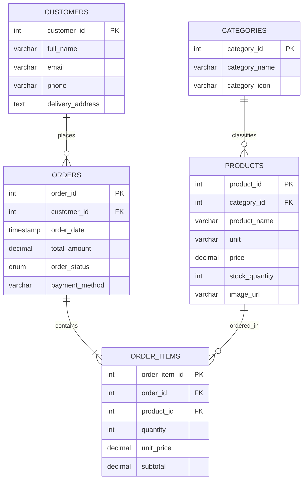

# ACADEMIC PROJECT REPORT: QuickKart

**Course / Subject:** Database Management Systems (DBMS) / DMGT  
**Academic Year:** 2nd Year B.Tech / B.E. / BCA / B.Sc (Computer Science)  
**Project Title:** QuickKart – Mini Grocery Shopping Website (Blinkit-Inspired Relational Database System)

---

## 1. Project Objective & Problem Statement

### 1.1 Objective
The objective of this project is to model, design, and implement an end-to-end **Relational Database Management System (RDBMS)** for an instant grocery delivery platform (inspired by Blinkit / Zepto). The project demonstrates core database concepts:
- Relational Schema Modeling
- Database Normalization (up to 3NF)
- Referential Integrity via Primary & Foreign Keys
- SQL Data Definition Language (DDL) and Data Manipulation Language (DML)
- Complex Multi-Table Queries using `INNER JOIN`
- Aggregations (`COUNT`, `SUM`, `AVG`) and Grouping (`GROUP BY`)
- Transaction Management (ACID Properties)

### 1.2 Comparison: Why QuickKart over Flat Data Analytics?
Generic online repositories (such as single-CSV sales analysis or PowerBI dashboards) only contain a single denormalized table with no relational structure, no primary/foreign keys, no 3NF normalization, and no live database transactional operations. 

In contrast, **QuickKart** implements a true 3-Tier relational architecture with 5 distinct tables (`Categories`, `Products`, `Customers`, `Orders`, and `Order_Items`), satisfying all university DBMS syllabus requirements.

---

## 2. System Architecture

The project follows a standard **3-Tier Client-Server Architecture**:

```text
[ Presentation Layer ]     HTML5, CSS3, JavaScript (Responsive Blinkit UI)
         │
         ▼ (HTTP Requests / Form Submissions)
[ Application Layer ]      PHP 8.x (PDO Controller, Transaction Manager, Query Engine)
         │
         ▼ (SQL Prepared Statements via TCP/Port 3306)
[ Database Storage Layer ] MySQL / MariaDB (InnoDB Storage Engine, Foreign Keys, B-Tree Indexes)
```

---

## 3. Database Design & Relational Modeling

### 3.1 Table Specifications

1. **`categories`**
   - **Purpose:** Classifies products into distinct sections (Dairy, Fruits, Cold Drinks, Snacks, etc.).
   - **Primary Key:** `category_id` (INT, AUTO_INCREMENT)
   - **Attributes:** `category_name` (VARCHAR 100, UNIQUE), `category_icon` (VARCHAR 100)

2. **`products`**
   - **Purpose:** Stores individual inventory items, prices, weight units, and available stock.
   - **Primary Key:** `product_id` (INT, AUTO_INCREMENT)
   - **Foreign Key:** `category_id` references `categories(category_id)` on DELETE CASCADE
   - **Attributes:** `product_name`, `unit`, `price`, `stock_quantity`, `image_url`

3. **`customers`**
   - **Purpose:** Holds customer contact and physical delivery addresses.
   - **Primary Key:** `customer_id` (INT, AUTO_INCREMENT)
   - **Attributes:** `full_name`, `email` (UNIQUE), `phone`, `delivery_address`

4. **`orders`**
   - **Purpose:** Stores transaction orders placed by customers.
   - **Primary Key:** `order_id` (INT, AUTO_INCREMENT)
   - **Foreign Key:** `customer_id` references `customers(customer_id)` on DELETE CASCADE
   - **Attributes:** `order_date`, `total_amount`, `order_status`, `payment_method`

5. **`order_items`**
   - **Purpose:** Junction/Associative table resolving the Many-to-Many ($M:N$) relationship between `Orders` and `Products`.
   - **Primary Key:** `order_item_id` (INT, AUTO_INCREMENT)
   - **Foreign Keys:**
     - `order_id` references `orders(order_id)` on DELETE CASCADE
     - `product_id` references `products(product_id)` on DELETE RESTRICT
   - **Attributes:** `quantity`, `unit_price`, `subtotal`

---

### 3.2 Entity-Relationship (ER) Diagram



---

### 3.3 Relational Schema Notation

The relational database schema with Primary Keys (PK) underlined and Foreign Keys (FK) marked:

- **CATEGORIES** (<ins>category_id</ins>, category_name, category_icon, created_at)
- **PRODUCTS** (<ins>product_id</ins>, category_id*, product_name, unit, price, stock_quantity, image_url, created_at)  
  *FK: `category_id` $\rightarrow$ `CATEGORIES(category_id)`*
- **CUSTOMERS** (<ins>customer_id</ins>, full_name, email, phone, delivery_address, created_at)
- **ORDERS** (<ins>order_id</ins>, customer_id*, order_date, total_amount, order_status, payment_method)  
  *FK: `customer_id` $\rightarrow$ `CUSTOMERS(customer_id)`*
- **ORDER_ITEMS** (<ins>order_item_id</ins>, order_id*, product_id*, quantity, unit_price, subtotal)  
  *FK1: `order_id` $\rightarrow$ `ORDERS(order_id)`*  
  *FK2: `product_id` $\rightarrow$ `PRODUCTS(product_id)`*

---

## 4. Normalization Analysis (1NF to 3NF)

### 4.1 First Normal Form (1NF)
- **Condition:** All attributes must hold atomic values; no repeating groups or multivalued attributes.
- **Verification:**
  - Each field (such as `phone`, `unit_price`, `quantity`) contains a single atomic scalar value.
  - Multi-item orders are not stored as delimited strings inside `orders`. Instead, they are split atomically across rows in `order_items`.

### 4.2 Second Normal Form (2NF)
- **Condition:** Must be in 1NF, and no non-prime attribute may depend on a proper subset of any candidate key (No Partial Dependency).
- **Verification:**
  - In `order_items`, the composite natural key is `(order_id, product_id)`. Non-key attributes like `quantity`, `unit_price`, and `subtotal` depend on the *entire* combination of both `order_id` and `product_id`.
  - Product-level attributes (`product_name`, `image_url`) are stored separately in `products`, avoiding partial dependencies.

### 4.3 Third Normal Form (3NF)
- **Condition:** Must be in 2NF, and no non-prime attribute may be transitively dependent on a candidate key ($X \rightarrow Y$ and $Y \rightarrow Z$).
- **Verification:**
  - In `products`, `category_name` is not stored directly. Only `category_id` is stored. Storing `category_name` in `products` would create a transitive dependency: `product_id -> category_id -> category_name`. Removing it into the `categories` table guarantees 3NF.
  - In `orders`, customer address and phone are not duplicated; only `customer_id` is stored.

---

## 5. SQL Demonstration & Implementation Matrix

| Concept | SQL Syntax Implemented | Location in Codebase |
| :--- | :--- | :--- |
| **CREATE TABLE** | Primary Keys, Foreign Keys, Constraints (`CHECK`, `ON DELETE CASCADE`) | `database/schema.sql` |
| **INSERT** | Seed data insertion, adding products, placing orders | `admin_actions.php`, `place_order.php` |
| **SELECT** | Fetching categories, products, customer records | `index.php`, `orders.php`, `admin.php` |
| **WHERE** | Filtering products by category ID, finding order by ID | `index.php`, `place_order.php` |
| **LIKE** | Keyword search across product names: `WHERE product_name LIKE '%keyword%'` | `index.php` |
| **ORDER BY** | Sorting products by price ascending (`ASC`) and descending (`DESC`) | `index.php` |
| **UPDATE** | Reducing stock inventory upon purchase: `SET stock_quantity = stock_quantity - ?` | `place_order.php` |
| **DELETE** | Removing discontinued inventory items: `DELETE FROM products WHERE product_id = ?` | `admin_actions.php` |
| **INNER JOIN** | Joining `orders` with `customers` and `order_items` with `products` | `orders.php`, `index.php` |
| **COUNT()** | Total orders count, count of products per category | `orders.php`, `admin.php` |
| **SUM()** | Calculating total store revenue from orders | `orders.php` |
| **AVG()** | Calculating average order value and category average price | `orders.php`, `admin.php` |
| **GROUP BY** | Grouping product statistics by category | `admin.php` |
| **ACID Transaction** | `beginTransaction()`, `commit()`, `rollBack()` | `place_order.php` |

---

## 6. Top 10 Viva Questions & Model Answers for 2nd Year Students

### Q1: What is the purpose of the `order_items` table? Why not store items inside `orders`?
> **Answer:** If we stored items directly in the `orders` table (e.g. as comma-separated values), it would violate the First Normal Form (1NF) which requires atomic values. Placing it in `order_items` resolves the Many-to-Many ($M:N$) relationship between `orders` and `products` into two 1-to-Many ($1:N$) relationships.

### Q2: How does QuickKart protect against SQL Injection?
> **Answer:** QuickKart uses **PHP PDO with Prepared Statements and Parameterized Queries** (`$stmt->prepare()` and `$stmt->execute([$param])`). User inputs are treated strictly as data literals and never concatenated directly into SQL command strings.

### Q3: What is the difference between `ON DELETE CASCADE` and `ON DELETE RESTRICT`?
> **Answer:**
> - `ON DELETE CASCADE` is used on `orders -> customers`: If a customer profile is deleted, their associated orders are also removed automatically.
> - `ON DELETE RESTRICT` is used on `order_items -> products`: If an admin tries to delete a product that was already purchased in a historical order, MySQL rejects the deletion to preserve invoice audit trails.

### Q4: How is the search feature implemented in SQL?
> **Answer:** It uses the `LIKE` operator with wildcard characters (`%`). For example:  
> `SELECT * FROM products WHERE product_name LIKE :keyword`  
> Binding `%milk%` matches any product name containing the word "milk".

### Q5: What are ACID properties and where are they demonstrated in this project?
> **Answer:** ACID stands for **Atomicity, Consistency, Isolation, and Durability**. In `place_order.php`, we invoke `$pdo->beginTransaction()`. If the customer is saved, the order is created, the order items are saved, and the inventory is decremented without errors, `$pdo->commit()` is executed. If any single query fails, `$pdo->rollBack()` restores the original database state.

### Q6: What is an aggregate function in SQL? Which ones did you use?
> **Answer:** Aggregate functions perform a calculation on multiple values in a column and return a single summary value. We used `COUNT()` (total orders placed), `SUM()` (total revenue in ₹), and `AVG()` (average order value) in `orders.php`.

### Q7: What does `GROUP BY` do?
> **Answer:** `GROUP BY` collapses rows that have the same values in specified columns into summary rows. In `admin.php`, we group products by `category_name` to count how many items exist per category and their average price.

### Q8: What database storage engine is used in MySQL and why?
> **Answer:** We use the **InnoDB** storage engine because it natively supports Foreign Key constraints, referential integrity checks, and ACID-compliant transaction rollbacks.

### Q9: Why did you choose HTML, CSS, JavaScript, PHP, and MySQL instead of MERN stack?
> **Answer:** For a 2nd-year academic DBMS / DMGT course, the objective is to master **Relational Database Design**, SQL querying, normalization, and relational integrity. NoSQL databases like MongoDB do not enforce tabular normalization or foreign key constraints. The PHP + MySQL LAMP stack provides a direct, transparent connection to the relational engine without ORM abstractions.

### Q10: How does the system handle concurrent cart purchases?
> **Answer:** Through database transactions and transactional `UPDATE` statements (`SET stock_quantity = GREATEST(0, stock_quantity - ?)`), ensuring inventory is decremented safely during the order placement commit.
