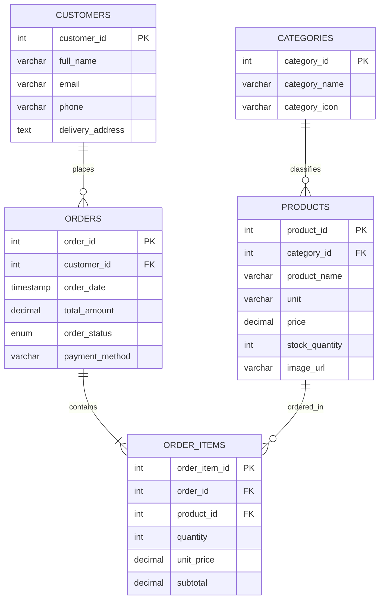

# PROJECT REPORT: QuickKart

**Course / Subject:** Database Management Systems (DBMS)
**Year:** 2nd Year B.Tech (Computer Science)
**Project Title:** QuickKart – Mini Grocery Shopping Website (Blinkit-inspired Relational Database System)
**Stack:** HTML, CSS, JavaScript · Node.js + Express · MySQL

---

## 1. Objective & Problem Statement

### 1.1 Objective
To design and implement a relational database for an instant grocery delivery platform (inspired by Blinkit / Zepto) and connect it to a working web application. The project demonstrates:

- Relational schema design and an ER model
- Normalization up to 3NF
- Referential integrity with primary and foreign keys (`CASCADE` vs `RESTRICT`)
- DDL and DML: `CREATE`, `INSERT`, `SELECT`, `UPDATE`, `DELETE`
- Multi-table `JOIN`s, aggregates (`COUNT`, `SUM`, `AVG`), `GROUP BY`, `HAVING`
- Subqueries and window functions (`RANK() OVER`, running totals) for sales analysis
- Transactions with ACID properties and row locking

### 1.2 Why a relational store instead of a single sales CSV?
A single-table sales dataset (like the Kaggle Blinkit CSV) is good for analysis but has no relationships, no keys and no live transactions. QuickKart stores the same kind of business data in **5 related tables**, takes real orders through the website, and then runs the sales analysis on that live data.

---

## 2. System Architecture (3-tier)

```text
[ Presentation Layer ]   HTML5, CSS3, JavaScript (EJS templates + browser cart)
          │
          ▼  HTTP requests / form submissions
[ Application Layer ]    Node.js + Express (routes, validation, transaction handling)
          │
          ▼  Parameterized SQL via mysql2 connection pool (TCP port 3306)
[ Database Layer ]       MySQL 8 / MariaDB (InnoDB engine, foreign keys, indexes)
```

| Layer | Files |
|-------|-------|
| Presentation | `views/*.ejs`, `public/css/style.css`, `public/js/app.js` |
| Application | `server.js`, `routes/store.js`, `routes/admin.js`, `routes/analytics.js` |
| Database | `config/db.js`, `database/schema.sql`, `database/queries_showcase.sql` |

---

## 3. Database Design

### 3.1 Tables

1. **`categories`**: product sections (Dairy, Fruits, Snacks, …)
   - PK `category_id` · `category_name` (UNIQUE) · `category_icon`
2. **`products`**: inventory items
   - PK `product_id` · FK `category_id` → `categories` (ON DELETE CASCADE)
   - `product_name`, `unit`, `price` (CHECK > 0), `stock_quantity` (CHECK ≥ 0), `image_url`
3. **`customers`**: buyers and delivery details
   - PK `customer_id` · `full_name`, `email` (UNIQUE), `phone`, `delivery_address`
4. **`orders`**: one row per order
   - PK `order_id` · FK `customer_id` → `customers` (ON DELETE CASCADE)
   - `order_date`, `total_amount`, `order_status` (ENUM), `payment_method`
5. **`order_items`**: junction table resolving the M:N relationship between orders and products
   - PK `order_item_id` · FK `order_id` → `orders` (CASCADE) · FK `product_id` → `products` (RESTRICT)
   - `quantity` (CHECK > 0), `unit_price`, `subtotal` · UNIQUE (`order_id`, `product_id`)

### 3.2 ER Diagram



### 3.3 Relational Schema

- **CATEGORIES** (<ins>category_id</ins>, category_name, category_icon, created_at)
- **PRODUCTS** (<ins>product_id</ins>, category_id\*, product_name, unit, price, stock_quantity, image_url, created_at)
- **CUSTOMERS** (<ins>customer_id</ins>, full_name, email, phone, delivery_address, created_at)
- **ORDERS** (<ins>order_id</ins>, customer_id\*, order_date, total_amount, order_status, payment_method)
- **ORDER_ITEMS** (<ins>order_item_id</ins>, order_id\*, product_id\*, quantity, unit_price, subtotal)

(\* = foreign key)

---

## 4. Normalization

### 1NF
Every column holds one atomic value. An order with several products is **not** stored as a comma-separated list inside `orders`; each product is its own row in `order_items`.

### 2NF
In `order_items`, the natural key is (`order_id`, `product_id`), enforced with a UNIQUE constraint. `quantity`, `unit_price` and `subtotal` depend on the whole pair, not on just one part. Product details such as `product_name` live in `products`, so there is no partial dependency.

### 3NF
`products` stores only `category_id`, not `category_name`. Storing the name would create a transitive dependency `product_id → category_id → category_name`. Likewise `orders` stores only `customer_id`, not the customer's phone or address.

**Note on `unit_price` in `order_items`:** this is not redundant with `products.price`. It records the price *at the time of purchase*, so old bills stay correct after a price change.

---

## 5. SQL Implementation Matrix

| Concept | Where it is used | File |
|---------|------------------|------|
| `CREATE TABLE`, PK, FK, `CHECK`, `UNIQUE`, indexes | Schema | `database/schema.sql` |
| `SELECT` + `INNER JOIN` + `WHERE` + `LIKE` + `ORDER BY` | Store page: search, filter, sort | `routes/store.js` |
| `INSERT` | Add product; new customer, order and items at checkout | `routes/admin.js`, `routes/store.js` |
| `UPDATE` | Reduce stock at checkout, restock, change order status | `routes/store.js`, `routes/admin.js` |
| `DELETE` + FK `RESTRICT` | Delete product (blocked if it was ordered) | `routes/admin.js` |
| `COUNT`, `SUM`, `AVG` | Orders page metrics | `routes/store.js` |
| `GROUP BY` + `LEFT JOIN` | Products per category | `routes/admin.js` |
| `HAVING` + subquery | Customers spending above the average customer | `routes/analytics.js` |
| `RANK() OVER (PARTITION BY …)` | Best-selling product in each category | `routes/analytics.js` |
| `SUM() OVER (ORDER BY …)` | Running revenue total by day | `routes/analytics.js` |
| `CASE` | Stock status labels | `routes/analytics.js` |
| Transaction + `SELECT … FOR UPDATE` | Place order | `routes/store.js` |

---

## 6. The Order Transaction (step by step)

`POST /place-order` in `routes/store.js` runs on a single connection:

1. `START TRANSACTION`
2. Find the customer by email, or `INSERT` a new one
3. `SELECT … FROM products WHERE product_id IN (…) FOR UPDATE`, which locks those rows so two shoppers cannot buy the last unit at the same time
4. Check stock and calculate the total **from database prices**. Prices sent by the browser are ignored, so they can't be tampered with.
5. `INSERT` into `orders`, then `INSERT` all lines into `order_items`
6. `UPDATE products SET stock_quantity = stock_quantity - ?`
7. `COMMIT`. If any step fails (e.g. not enough stock), `ROLLBACK` undoes **all** of the above, including a newly created customer.

---

## 7. Security Measures

- **SQL injection:** every user value is passed as a `?` placeholder to `mysql2`, never concatenated into SQL. The only dynamic SQL fragment, `ORDER BY`, is chosen from a fixed whitelist.
- **Price tampering:** totals are recalculated on the server from the `products` table.
- **XSS:** EJS `<%= %>` escapes all output. The browser cart escapes text before inserting it into the page.
- **Safe deletes:** deleting uses a `POST` form, never a plain link, so simply visiting a URL cannot delete data.
- **Credentials:** stored in `.env`, which is excluded from Git by `.gitignore`.

---

## 8. Viva Questions & Model Answers

**Q1. Why is there an `order_items` table? Why not store items inside `orders`?**
Storing several products in one `orders` column would break 1NF. `order_items` turns the many-to-many relationship between orders and products into two one-to-many relationships.

**Q2. How does the project prevent SQL injection?**
With parameterized queries: `pool.query('… WHERE email = ?', [email])`. The `mysql2` driver escapes the value, so input is always treated as data, never as SQL.

**Q3. Difference between `ON DELETE CASCADE` and `ON DELETE RESTRICT`?**
`CASCADE` (orders → customers): deleting a customer also deletes their orders. `RESTRICT` (order_items → products): MySQL refuses to delete a product that appears in any order, which protects old bills. Try it on the Admin page.

**Q4. How does search work?**
`WHERE p.product_name LIKE ? OR c.category_name LIKE ?` with the value `%milk%`. The `%` wildcards match any text before or after the word.

**Q5. What are ACID properties, and where are they used?**
Atomicity, Consistency, Isolation, Durability. Placing an order is one transaction: either the customer, order, items and stock changes are all saved (`COMMIT`), or none are (`ROLLBACK`). `FOR UPDATE` row locks provide isolation between simultaneous orders.

**Q6. What is the difference between `WHERE` and `HAVING`?**
`WHERE` filters rows *before* grouping. `HAVING` filters groups *after* `GROUP BY`, so it can use aggregates such as `SUM(total_amount) > 500`.

**Q7. What is a window function? How is it different from `GROUP BY`?**
`GROUP BY` collapses rows into one row per group. A window function such as `RANK() OVER (PARTITION BY category ORDER BY units DESC)` computes a value for every row while keeping the rows. We use it to find the best seller in each category; ties get the same rank, which is why one category can show two products.

**Q8. Why InnoDB?**
It supports foreign keys, transactions with rollback, and row-level locking. MyISAM supports none of these.

**Q9. Why Node.js + MySQL instead of MongoDB (MERN)?**
The goal of a DBMS project is relational design: tables, keys, joins and normalization. MongoDB is a document database with no foreign keys or joins in the same sense. Node.js with the `mysql2` driver lets us write plain SQL with no ORM hiding it.

**Q10. Why use a connection pool?**
Opening a MySQL connection is slow. The pool (`config/db.js`) keeps up to 10 connections open and reuses them across requests. For a transaction we borrow one connection with `pool.getConnection()` so every step runs on the same session, then release it.

**Q11. Why do we store `unit_price` in `order_items` if `products` already has `price`?**
Prices change over time. `unit_price` records what the customer actually paid, so old orders and revenue reports stay correct.

**Q12. What happens if two people try to buy the last item at the same time?**
The first transaction locks the product row with `SELECT … FOR UPDATE`. The second waits until the first commits, then sees the updated stock (0) and is rejected with a rollback.
